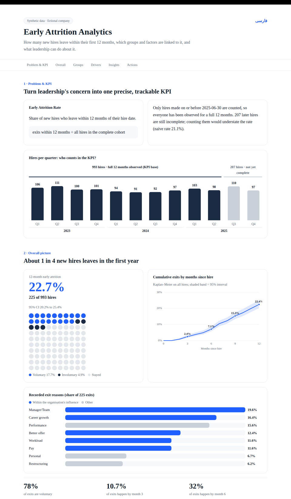
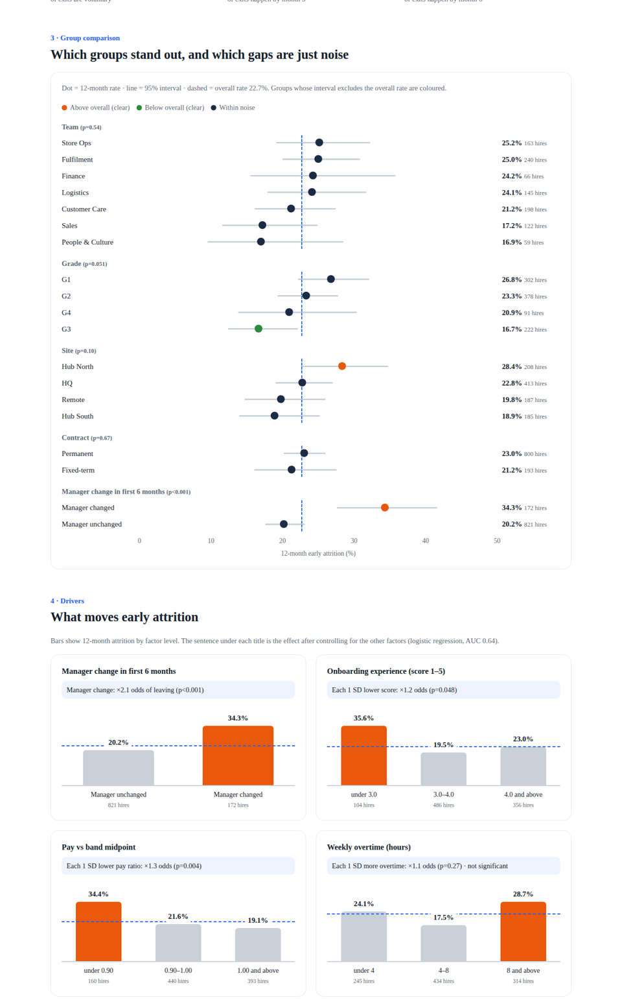
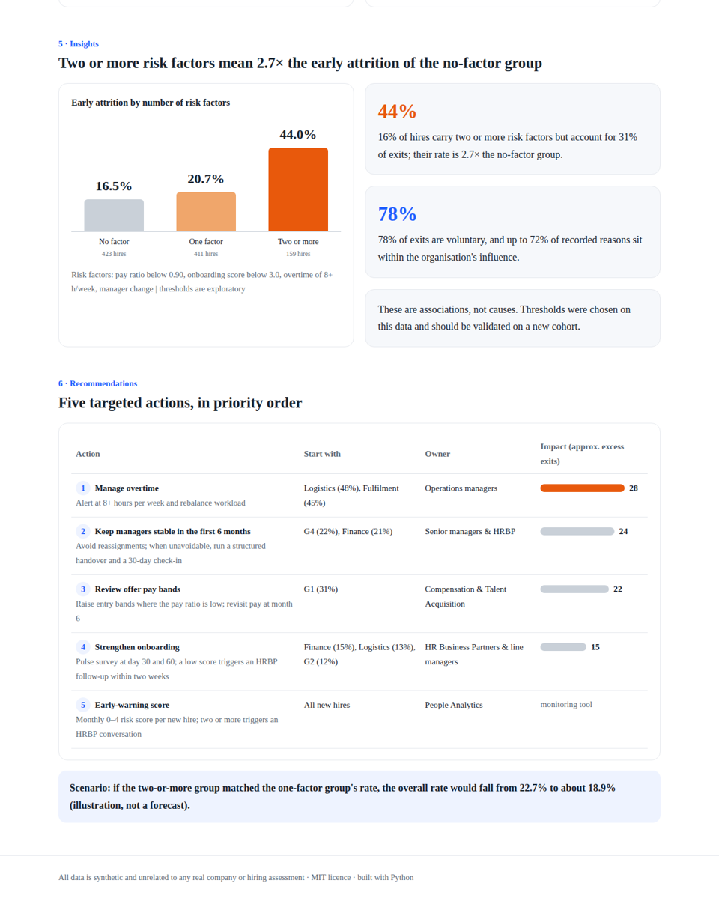

# Early Attrition Analytics

[](https://github.com/Milad-Shabani/early-attrition-analytics/actions/workflows/ci.yml)
[](LICENSE)

Censoring-aware **early-attrition analytics** for people-analytics teams: how many new hires leave within their first
12 months, which groups and factors are linked to it, and what leadership can do about it. The pipeline ends in a
**self-contained, bilingual HTML report** (English and Persian/RTL) with no external requests.

**Live demo:** <https://milad-shabani.github.io/early-attrition-analytics/> ·
[English report](docs/early_attrition_en.html) · [گزارش فارسی](docs/early_attrition_fa.html) · [README فارسی](README.fa.md)



> **Synthetic data.** The demo cohort is generated by [`synth.py`](src/attrition/synth.py) for a *fictional* retail &
> logistics company. No real employee data, company or hiring assessment is involved; effect sizes are set by the
> generator and mean nothing outside this demo.

## What it does

| Step | Question | Method |
|---|---|---|
| 1. KPI | What is the early-attrition rate, correctly? | Complete-cohort rate (everyone observed for 12 months) with Wilson 95% interval; naive rate shown to expose censoring bias |
| 2. Overall | When do people leave, and why? | Kaplan–Meier curve with Greenwood interval, exit-reason shares, voluntary share |
| 3. Groups | Which gaps are real? | Wilson intervals per team / grade / site / contract / manager change; colour only when the interval excludes the overall rate |
| 4. Drivers | What moves attrition? | Logistic regression (standardised predictors) translated to plain-language odds, dose-response bars |
| 5. Insights | Do risks stack? | 0 / 1 / 2+ risk-factor groups; share of hires vs. share of exits |
| 6. Actions | Where to start? | Excess exits per factor, priority segments, owner and a scenario target |

## Quick start

```bash
git clone https://github.com/Milad-Shabani/early-attrition-analytics.git
cd early-attrition-analytics
pip install -e ".[dev]"

python -m attrition build          # writes data/synthetic_hires.csv and docs/early_attrition_{en,fa}.html
python -m pytest -q                # 10 tests
python -m http.server 8000 --directory docs
```

Options: `--n 1200 --seed 11 --obs-end 2026-06-30 --out docs --data-out data/synthetic_hires.csv`.

## Use your own data

```bash
python -m attrition build --csv my_hires.csv --obs-end 2026-06-30 --out my_reports
```

| Column | Type | Notes |
|---|---|---|
| `hire_id` | text | unique id |
| `hire_date` | date | |
| `exit_date` | date or empty | empty = still employed (censored) |
| `exit_type`, `exit_reason` | text or empty | `Voluntary` / `Involuntary`; reasons listed in `i18n.py` are translated |
| `team`, `grade`, `site`, `contract` | text | `contract` uses `Fixed-term` / `Permanent` |
| `pay_ratio` | float | pay ÷ band midpoint |
| `weekly_overtime_h` | float | |
| `onboarding_score` | float 1–5 or empty | missing values are excluded from the model only |
| `manager_changed` | 0 / 1 | manager change in the first 6 months |

Thresholds for the risk flags live in `analysis.Config`. Add translations for new categories in `src/attrition/i18n.py`.

## Project layout

```
src/attrition/   synth.py (data) · analysis.py (statistics) · report.py (HTML) · i18n.py (EN/FA) · __main__.py (CLI)
tests/           pytest suite (censoring, KM, intervals, model, report build)
docs/            generated reports (served by GitHub Pages) + methodology.md
.github/         CI (tests on 3.10–3.12) and Pages deployment
publish.sh/.bat  one-command publish with the GitHub CLI
```

More detail: [docs/methodology.md](docs/methodology.md).

## Screenshots

| Groups and drivers | Insights and actions |
|---|---|
|  |  |

Persian report (right-to-left, Persian digits, numeric axes left-to-right): [overview](docs/screenshots/fa_overview.png).

## Publish

With the [GitHub CLI](https://cli.github.com) signed in: `./publish.sh` (or `publish.bat` on Windows). It creates the repository,
pushes, sets topics and enables GitHub Pages from the workflow.

## License

[MIT](LICENSE) © 2026 Milad Shabani
